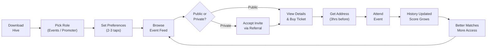

# Hive — MVP Storyboard

> Underground techno event discovery · Ticketing · Referral access · Promoter tools

---

## Product Vision

Hive answers one question: **"What's happening tonight?"** — for people embedded in the underground techno scene. It connects **event-goers** who want to discover the right events with **promoters** who want to reach the right audience.

### Core Value Props

| For Event-Goers | For Promoters |
|---|---|
| Discover events matched to your taste | Reach people who actually care about your sound |
| Get access to private/invite-only events | Control who sees & attends your events |
| Build an event history that unlocks more access | Filter attendees by scene credibility & taste |
| Never miss the right party | Sell tickets with zero friction |

---

## Flow 1 — Onboarding (First Open)

The user picks their role immediately. No sign-up wall before seeing value.


**What happens:**
1. User opens app → sees the welcome screen
2. Taps **"I'm here for events"** or **"I'm a promoter"**
3. Quick auth (phone number or Apple/Google sign-in — no email forms)
4. Proceeds to preference setup

> [!TIP]
> The "Skip" button lets impatient users go straight to the event feed. Preferences can be set later. **Reducing friction to first value is critical.**

---

## Flow 2 — Preference Setup (2-3 Taps)

Quick, tactile onboarding — not a survey. Users tap genres and follow artists.


**What happens:**
1. **"What moves you?"** — tap 2-5 subgenre chips (Acid, Minimal, Hard Techno, Industrial, etc.)
2. **"Artists you follow"** — search and select favorite DJs/producers. Optional Spotify/SoundCloud link to auto-import
3. Done. Feed is now personalized

**Ranking algo kicks in here:**
```
match_score = (genre_overlap × 0.4) + (artist_similarity × 0.3) 
            + (vibe_match × 0.15) + (price_fit × 0.1) + (time_fit × 0.05)
```

> [!NOTE]
> This preference profile improves passively over time via attendance history — no need for the user to manually update it.

---

## Flow 3 — Event Feed (Core Loop)

The main screen. Ranked event cards with match scores, genre tags, and private event indicators.


**What the user sees:**
- Event cards ranked by **match score** (e.g., "92% Match")
- Genre tags on each card for quick scanning
- **🔒 Lock icon** on private/invite-only events
- Save/bookmark events for later
- Bottom nav: **Feed · Search · Tickets · Profile**

**Interaction patterns:**
- Scroll to browse → Tap card for details
- Pull to refresh for latest events
- Filter by date / genre / price / distance

---

## Flow 4 — Event Detail & Ticketing

Deep dive into an event. Lineup, location (hidden until close to event time), and ticket purchase.


**Key elements:**
- **Hero image** — moody, atmospheric
- **Lineup** — artist names + avatars, tappable to follow
- **Location** — "Address revealed 3hrs before event" 🔒 (builds anticipation, protects venue)
- **Ticket tiers** — Early Bird / General / Door pricing
- **"Get Tickets"** — in-app purchase, ticket goes to Tickets tab
- **"Refer a friend"** — share a referral link to bring friends

**After purchase:**
- Ticket appears in **Tickets** tab with QR code
- Address is revealed X hours before the event via push notification
- Event is logged to **attendance history** automatically

---

## Flow 5 — Private Event Invite & Referral Chain

This is the **killer feature**. Exclusive access through trusted referral chains.


**How it works:**
1. Promoter creates an **Invite Only** event
2. Promoter sends initial invites to trusted contacts
3. Each invitee gets a **referral code** and can invite up to N friends (set by promoter)
4. Referral chain is tracked — promoter sees the trust graph

**Why this matters:**
- Promoters control the crowd without manually vetting everyone
- Users feel exclusive and trusted — drives organic sharing
- Referral chains create **viral loops** within the scene
- Bad actors can be traced and removed via the chain

> [!IMPORTANT]
> The referral chain is the primary growth mechanism. Each private event is an acquisition event — new users join Hive specifically to accept an invite.

---

## Flow 6 — User Profile & Event History

The user's identity in the scene. Their history, taste profile, and credibility score.


**What's shown:**
- **Stats**: Events attended · Referrals made · Hive Score
- **Event History**: Timeline of past events with thumbnails & genre tags
- **Genre Breakdown**: Visual chart of most-attended subgenres (builds passively)
- **Hive Score**: Reputation metric based on attendance + referrals + behavior

**Why event history is powerful:**
- Feeds the ranking algorithm (implicit preferences > explicit surveys)
- Promoters can filter attendees by history ("only show to users with 3+ events")
- Creates a **portable scene identity** — your reputation on the platform

---

## Flow 7 — Promoter: Create Event

Promoters get purpose-built tools for underground events — not a generic Eventbrite clone.


**What promoters configure:**
- **Event details**: Name, date/time, lineup, genre tags
- **Venue type**: Warehouse · Club · Outdoor · Loft (affects how location is handled)
- **Ticket tiers**: Multiple price tiers with quantity caps
- **Visibility**: Public or Invite Only
- **Referral Chain Settings**: Max invites per person, chain depth
- **Audience Filter**: Min events attended, genre affinity match — ensures the right crowd discovers the event

> [!TIP]
> The Audience Filter is the B2B differentiator. No other platform lets promoters say *"only show this to people who've been to 3+ hard techno events."*

---

## User Journey Summary



---

## MVP Scope — What's In / What's Out

| ✅ In for MVP | ❌ Out for MVP |
|---|---|
| Event feed with match ranking | AI-powered group recommendations |
| Genre/artist preference onboarding | Spotify/SoundCloud auto-import |
| In-app ticketing (Stripe) | Multi-city support |
| Private event referral chains | Chat/messaging between users |
| User profile with event history | Live map / crowd signals |
| Promoter event creation | Promoter analytics dashboard |
| Hive Score (basic: events + referrals) | Advanced trust scoring / ML |
| Push notifications (address reveal) | Social features (follows, comments) |
| Single city launch (Seattle) | Artist profiles / pages |

---

## Technical Stack (Suggested)

| Layer | Tech | Why |
|---|---|---|
| **Mobile** | React Native (Expo) | Cross-platform, fast iteration, large ecosystem |
| **Backend** | Node.js + Express or Next.js API routes | JS ecosystem consistency, fast to build |
| **Database** | PostgreSQL + Prisma | Relational data (users, events, tickets, referrals), strong ORM |
| **Auth** | Clerk or Supabase Auth | Phone/social sign-in out of the box |
| **Payments** | Stripe Connect | Marketplace ticketing with split payouts to promoters |
| **Push** | Expo Notifications or OneSignal | Address reveal, event reminders |
| **Hosting** | Vercel (API) + AWS S3 (media) | Simple, scalable, affordable at launch |

---

## Go-To-Market: Seattle Launch

1. **Week 1-2**: Sign 5-10 Seattle techno promoters. Offer free ticketing for 3 months
2. **Week 3-4**: Soft launch at 2-3 events. Promoters send invite links to their existing audience
3. **Month 2**: Every private event invite = new Hive user. Referral chain drives organic growth
4. **Month 3**: 500+ active users in Seattle. Start charging ticketing fees (5-8%)
5. **Month 4+**: Expand to Portland, LA, or Brooklyn based on organic demand
